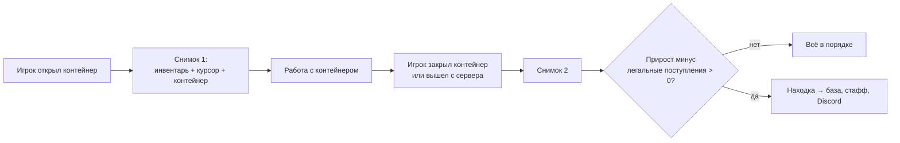

# DupeGuard

[](https://github.com/TTcux1/DupeGuard/actions/workflows/build.yml)

Плагин для серверов **Paper 1.21**, который отслеживает подозрительные операции с предметами и сообщает о возможных дюпах стаффу: в игре, в Discord и в базу данных.

Плагин **только наблюдает**: он ничего не отменяет и никого не банит. Его задача — быстро показать администрации, где и у кого предметы появились из ниоткуда, чтобы дюп нашли и закрыли до того, как он сломает экономику сервера.

## Как это работает

Главная проверка основана на **законе сохранения предметов**.

Когда игрок открывает сундук, бочку, шалкер или эндер-сундук, плагин делает снимок всей системы: инвентарь игрока, броня, вторая рука, предмет на курсоре и содержимое контейнера. Вложенные шалкеры и мешки тоже раскрываются, потому что дюпы чаще всего размножают именно заполненные шалкеры.

Пока контейнер открыт, предметы перекладываются между частями системы, но их **общее количество не может вырасти**. При закрытии плагин делает второй снимок и сравнивает:



Убыль предметов не считается подозрительной: их можно выбросить, их может забрать воронка. Легальные поступления во время сессии (подбор с земли, воронка, кладущая предмет в открытый сундук) вычитаются из прироста.

## Что обнаруживается

| Находка | Когда срабатывает | Серьёзность |
| --- | --- | --- |
| Прирост предметов в контейнере | Предметов в системе стало больше, чем было при открытии | HIGH (MEDIUM, если контейнер одновременно открыт у нескольких игроков) |
| Выход с сервера с приростом | То же, но игрок отключился с открытым контейнером: классический сценарий дюпа | CRITICAL |
| Переполненный стак | Стак больше максимального размера, например 5 тотемов в одной ячейке | HIGH |
| Всплеск подбора ценных предметов | Больше N ценных предметов одного типа подобрано за окно времени | MEDIUM |
| Флуд кликами в инвентаре | Больше N кликов в секунду: макросы или пакетные эксплойты | LOW |

## Установка

1. Скачайте `DupeGuard-x.y.z.jar` из [Releases](../../releases) или соберите сами (см. ниже).
2. Положите файл в папку `plugins/` сервера Paper 1.21+.
3. Перезапустите сервер и настройте `plugins/DupeGuard/config.yml`.

Требования: Paper 1.21+, Java 21. Дополнительные зависимости не нужны: SQLite-драйвер уже входит в Paper.

## Команды и права

| Команда | Что делает | Право |
| --- | --- | --- |
| `/dupeguard alerts` | Включить или выключить алерты для себя | `dupeguard.alerts` |
| `/dupeguard lookup <ник> [кол-во]` | Последние находки по игроку | `dupeguard.lookup` |
| `/dupeguard stats` | Статистика находок с момента запуска | `dupeguard.lookup` |
| `/dupeguard reload` | Перечитать config.yml | `dupeguard.admin` |

Алиас команды: `/dg`. Право `dupeguard.bypass` исключает игрока из проверок, например для тестовых аккаунтов. Игроки в креативе и наблюдении не проверяются.

Алерт в чате кликабельный: нажатие открывает историю игрока.

## Настройка

Все пороги, список контейнеров и ценных предметов, минимальный уровень алертов и Discord-вебхук настраиваются в [`config.yml`](src/main/resources/config.yml). Каждый параметр прокомментирован.

## Архитектура

```
src/main/java/dev/dupeguard/
├── core/       Логика детекции. Не зависит от Bukkit, полностью покрыта тестами
│   ├── ContainerAuditor      закон сохранения предметов
│   ├── ActivityDetector      клики, подбор, переполненные стаки
│   ├── SlidingWindowCounter  счётчик в скользящем окне
│   ├── AlertThrottle         защита стаффа от спама алертами
│   └── DiscordPayload        JSON для вебхука без сторонних библиотек
├── storage/    SQLite-хранилище, все запросы в отдельном потоке
└── plugin/     Связка с Paper: события, команды, конфиг, подсчёт предметов
```

Ключевые решения:

- **Ядро отделено от Bukkit.** Детекторы получают на вход простые данные и `Clock`, поэтому тестируются обычными юнит-тестами без запуска сервера.
- **Главный поток не блокируется.** Запись в базу и запросы истории идут в отдельном потоке, отправка в Discord асинхронная.
- **Проверяются только настоящие блоки-хранилища.** GUI-меню других плагинов тоже имеют тип CHEST, но законно выдают предметы. Поэтому плагин проверяет держателя инвентаря и пропускает меню, иначе каждый магазин давал бы ложные срабатывания.
- **Приоритет MONITOR.** Плагин видит итоговое состояние после всех остальных плагинов и ничего не меняет.

## Сборка и тесты

```bash
./gradlew build
```

Готовый jar появится в `build/libs/`. Тесты запускаются автоматически при сборке и в GitHub Actions на каждый push.

## Ограничения

Честно о том, где возможны ложные срабатывания:

- Плагины, которые выдают предметы игроку, пока у него открыт сундук (награды по таймеру и т. п.), будут выглядеть как прирост. Такие находки стоит проверять вручную.
- Предметы сравниваются по материалу. Подмена NBT при том же материале (например, зачарований) этой проверкой не ловится.
- Флуд кликами может срабатывать на очень быстрых игроках с сортировкой инвентаря. Порог настраивается.

## Планы

- [ ] Учёт кастомных предметов по ключу (PDC / CustomModelData)
- [ ] Веб-панель с историей находок
- [ ] Поддержка Folia
- [ ] Экспорт находок в CSV

## Лицензия

[MIT](LICENSE)
